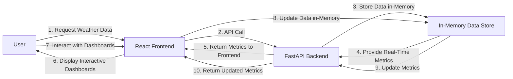

# Executive Summary
The ram-weather-optimizer-pro-max-plus-alt-7 project aims to optimize Windows 11's built-in Weather app RAM usage by providing real-time metrics and interactive dashboards. The project utilizes a FastAPI backend, a React frontend, and Tailwind CSS for styling.

# Architecture Overview
The project consists of two main components: the FastAPI backend and the React frontend. The FastAPI backend handles API requests, stores data in-memory, and provides real-time metrics. The React frontend interacts with the backend through API calls, displays interactive dashboards, and provides a user-friendly interface.

## Backend Architecture
The FastAPI backend is designed to handle API requests, store data in-memory, and provide real-time metrics. The backend consists of the following components:
* **app.py**: The main application file that defines the FastAPI app, loads environment variables, and configures CORS middleware.
* **test_app.py**: A test suite that verifies the functionality of the backend API endpoints.
* **requirements.txt**: A file that lists the dependencies required to run the backend.

## Frontend Architecture
The React frontend is designed to interact with the backend through API calls, display interactive dashboards, and provide a user-friendly interface. The frontend consists of the following components:
* **package.json**: A file that lists the dependencies required to run the frontend.
* **vite.config.js**: A configuration file for the Vite development server.
* **index.html**: The main entry point for the React application.
* **main.jsx**: The main application file that renders the App component.
* **App.jsx**: A component that displays interactive dashboards and provides a user-friendly interface.

## End-to-End System Architecture Flow Diagram

## API Contracts
The FastAPI backend provides the following API endpoints:
* **POST /data**: Stores data in-memory and returns a success message.
* **GET /metrics**: Returns real-time metrics.
* **POST /reset**: Resets the in-memory data store.

## Frontend Component Architecture
The React frontend consists of the following components:
* **App**: The main application component that displays interactive dashboards.
* **Dashboard**: A component that displays real-time metrics.
* **Form**: A component that allows users to interact with the dashboards.

## Automated Testing Setup
The project uses pytest to test the backend API endpoints. The test suite consists of the following tests:
* **test_app.py**: A test suite that verifies the functionality of the backend API endpoints.

## Step-by-Step Local Running Instructions
To run the project locally, follow these steps:
1. Install the backend dependencies: `pip install -r requirements.txt`
2. Start the backend: `uvicorn backend.app:app --reload --port 8000`
3. Install the frontend dependencies: `cd frontend && npm install`
4. Start the frontend: `npm run dev`
5. Open a web browser and navigate to `http://localhost:5173` to access the React frontend.

## CORS Configuration
The FastAPI backend is configured to allow CORS requests from the React frontend. This allows the frontend to make API calls to the backend without being blocked by the browser's same-origin policy. The CORS configuration is defined in the **app.py** file.