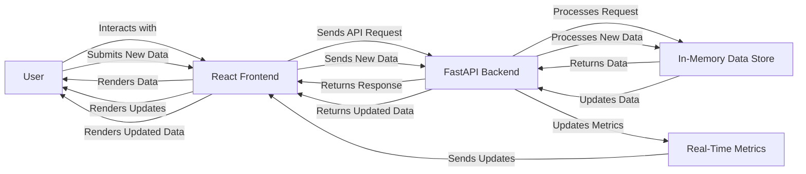

# ram-weather-optimizer-pro-max-plus-alt-7

## Executive Overview
The ram-weather-optimizer-pro-max-plus-alt-7 project aims to optimize Windows 11's built-in Weather app RAM usage with real-time metrics and interactive dashboards. This project utilizes FastAPI, Python, React (Vite), and TailwindCSS to provide a comprehensive solution.

## Feature Breakdown
* Real-time RAM usage monitoring
* Interactive dashboards for data visualization
* FastAPI backend for handling API requests
* React frontend for user interaction
* TailwindCSS for styling and layout

## API Contract Summary
The API consists of the following endpoints:
* `GET /metrics`: Retrieves real-time RAM usage metrics
* `POST /data`: Submits new data for processing
* `GET /data`: Retrieves processed data
* `POST /reset`: Resets the in-memory data store

## Step-by-Step Commands
To run the project, follow these steps:
1. Install backend packages: `pip install -r requirements.txt`
2. Start the backend: `uvicorn backend.app:app --reload --port 8000`
3. Setup and start the frontend: `cd frontend && npm install && npm run dev`

## CORS Explanation
CORS (Cross-Origin Resource Sharing) allows the React frontend to communicate with the FastAPI backend, which is running on a different port. This is necessary because web browsers enforce same-origin policy, which prevents JavaScript from making requests to a different origin (domain, protocol, or port) than the one the web page was loaded from. By configuring CORS, we can allow the frontend to make requests to the backend, enabling seamless communication between the two.

## End-to-End System Architecture Flow Diagram

This diagram illustrates the step-by-step flow of the system, from user interaction to data processing and rendering. The React frontend communicates with the FastAPI backend, which processes requests and updates the in-memory data store. The backend also updates real-time metrics, which are rendered by the frontend. The user can submit new data, which is processed by the backend and updated in the data store.